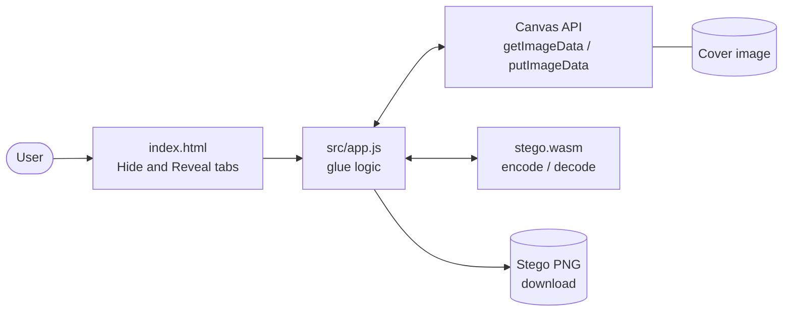
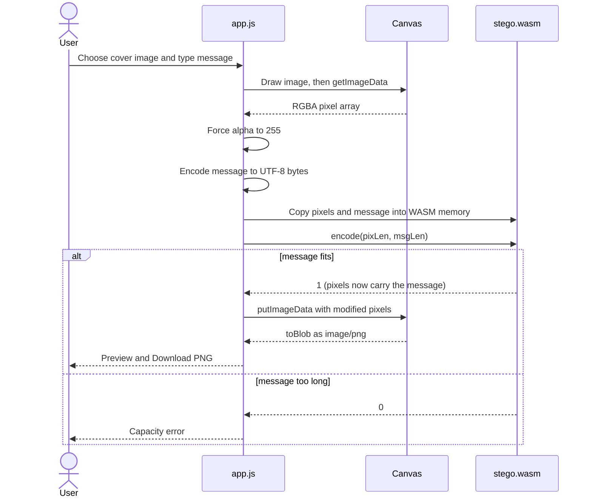
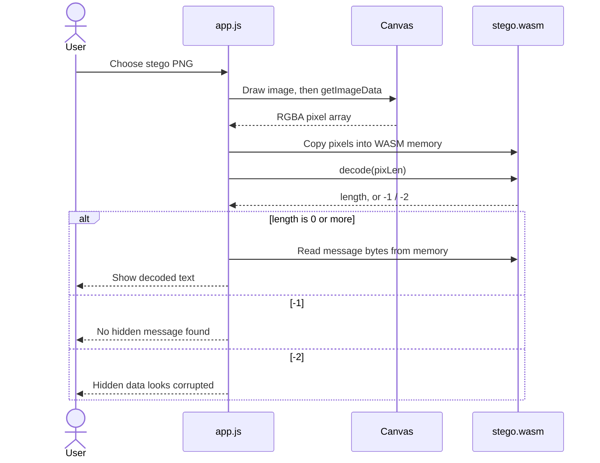
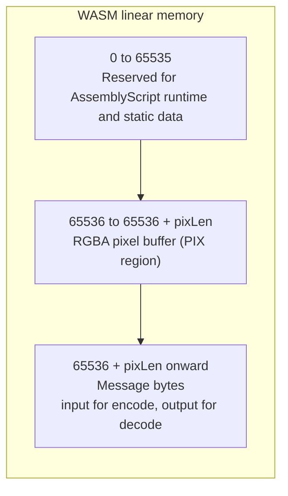
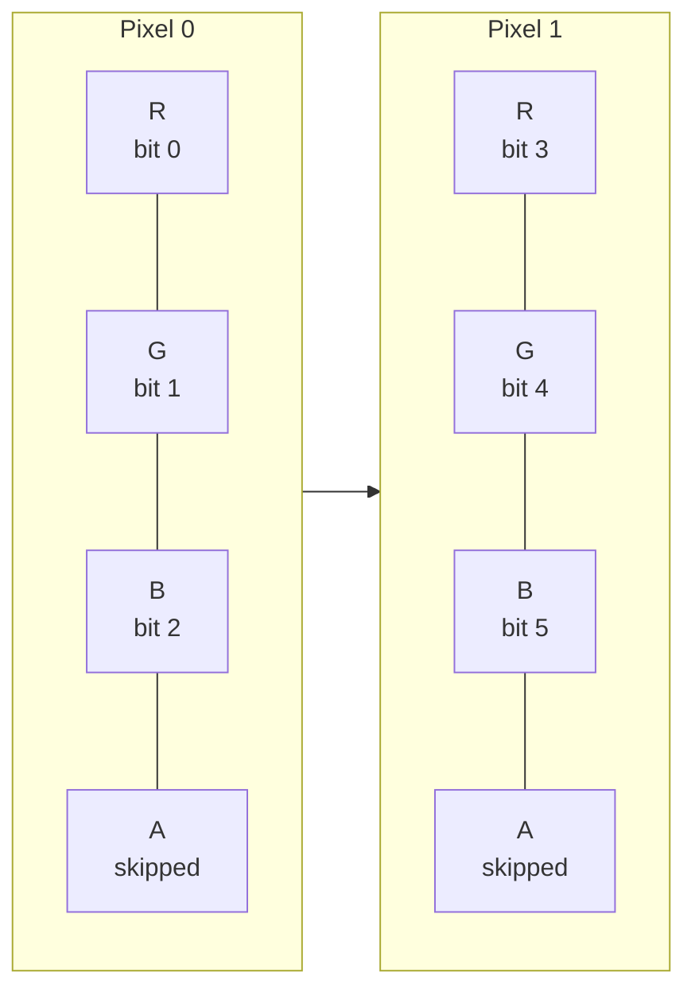
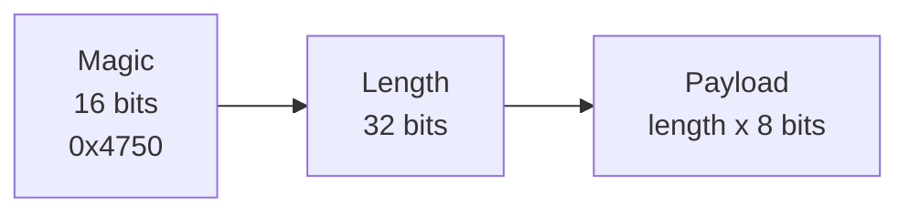
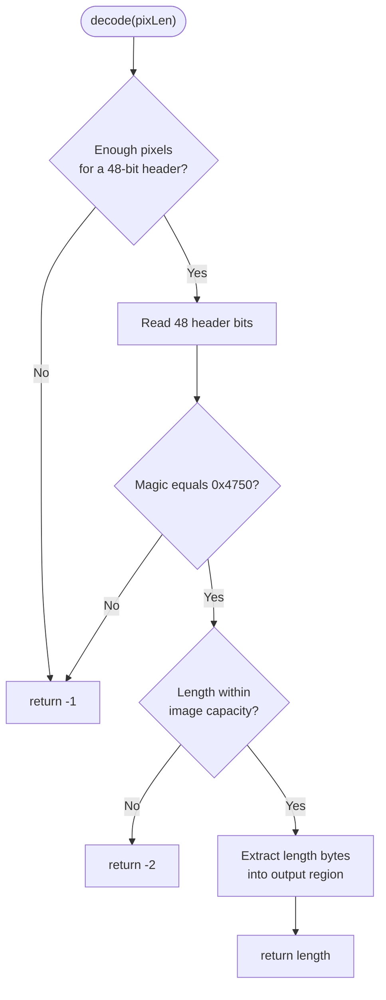

# GhostPixel Architecture

This document explains how GhostPixel is structured, how data flows through it, and why key design decisions were made. For setup and usage, see the [README](README.md).

## Contents

- [Overview](#overview)
- [Component Diagram](#component-diagram)
- [Hide Flow](#hide-flow)
- [Reveal Flow](#reveal-flow)
- [WASM Memory Layout](#wasm-memory-layout)
- [Bit Embedding Scheme](#bit-embedding-scheme)
- [Header Format](#header-format)
- [Decode Decision Logic](#decode-decision-logic)
- [WASM API](#wasm-api)
- [Design Decisions](#design-decisions)
- [Security Considerations](#security-considerations)
- [Extension Points](#extension-points)

## Overview

GhostPixel is a static web app with no backend. The browser handles file selection and image decoding, and a small WebAssembly module performs the bit-level work.

| Component | File | Responsibility |
|---|---|---|
| UI | `index.html`, `src/style.css` | Tabs, inputs, status and result display |
| Glue | `src/app.js` | File to canvas to pixel buffer, WASM calls, PNG export |
| Core | `wasm/index.ts` → `wasm/stego.wasm` | LSB encode and decode over raw RGBA bytes |

## Component Diagram



## Hide Flow



## Reveal Flow



## WASM Memory Layout

JS and WASM communicate through shared linear memory. JS writes inputs, calls an exported function, then reads the outputs.



- The pixel buffer starts at the constant `PIX = 65536`. The same constant is defined in both `wasm/index.ts` and `src/app.js` and **must stay in sync**.
- Before copying data in, JS calls `memory.grow()` if the buffer would not fit.
- Memory is grown in 64 KiB pages.

## Bit Embedding Scheme

Message bit number `i` is stored in the lowest bit of one colour byte. Alpha bytes are skipped.

```text
pixel index  = floor(i / 3)
channel      = i mod 3            (0 = R, 1 = G, 2 = B)
byte offset  = pixel index * 4 + channel
```



Bits are written **most significant bit first**, byte after byte.

**Capacity**

```text
capacity (bytes) = floor((width * height * 3 - 48) / 8)
```

For example, a 4320×3240 image holds about 5.2 MB.

## Header Format

Every embedded message begins with a 48-bit header, written MSB first, before the payload.

| Bits | Field | Value |
|---|---|---|
| 0 to 15 | Magic | `0x4750` (ASCII "GP") |
| 16 to 47 | Length | Payload size in bytes (unsigned 32-bit) |
| 48 onward | Payload | UTF-8 message bytes |



## Decode Decision Logic



## WASM API

Exported from `wasm/index.ts`:

| Function | Parameters | Returns |
|---|---|---|
| `capacityBytes` | `pixLen: i32` (bytes in RGBA buffer) | Maximum payload size in bytes |
| `encode` | `pixLen: i32`, `msgLen: i32` | `1` on success, `0` if the message does not fit |
| `decode` | `pixLen: i32` | Message length, `-1` if no message, `-2` if length is corrupt |

The module is compiled with `--runtime stub` and `--optimize` to keep the binary small, since it needs no heap allocation.

## Design Decisions

| Decision | Reason |
|---|---|
| **WebAssembly for the core** | Bit-twiddling over millions of bytes is fast in WASM and shows a practical use of the technology. |
| **AssemblyScript instead of Rust** | TypeScript-like syntax, one npm dependency, tiny output, no extra toolchain. |
| **Shared linear memory, no allocator** | JS controls the layout, so the `stub` runtime is enough and the module stays tiny. |
| **Alpha channel skipped and forced to 255** | Canvas premultiplies alpha, which would silently alter low bits on transparent pixels. |
| **PNG output only** | PNG is lossless, so embedded bits survive. JPEG would destroy them. |
| **Magic number plus length header** | Lets Reveal reject ordinary images and reject corrupt lengths instead of returning garbage. |
| **Fully client-side** | The secret and the image never leave the user's device. |

## Security Considerations

| Property | Status | Notes |
|---|---|---|
| Imperceptibility | Yes | Each channel changes by at most 1 out of 255. |
| Confidentiality | No | Data is hidden but not encrypted. |
| Resistance to steganalysis | Low | Sequential LSB embedding is detectable by chi-square and RS analysis. |
| Robustness to image edits | None | Compression, resize, crop and filters destroy the payload. |
| Integrity check | Partial | The magic number and length bounds detect "not ours" and "corrupt length", but not altered payload bytes. |

## Extension Points

- **Encryption**: encrypt the payload with AES-GCM (Web Crypto API) in `app.js` before copying it into WASM. The WASM core needs no change because it only handles bytes.
- **Randomised embedding**: replace `bitOffset(i)` in `wasm/index.ts` with a keyed pseudo-random permutation of pixel positions.
- **File payloads**: `app.js` already passes raw bytes to WASM, so hiding files only needs a file picker and a filename field in the header.
- **Integrity**: add a CRC32 or HMAC after the payload and verify it in `decode`.
